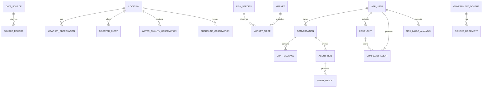

# AquaPulse Database Schema

**Document:** `database_schema.md`  
**Project:** AquaPulse — AI-Powered Smart Fisheries & Coastal Safety System  
**Pilot geography:** Palghar, Maharashtra, India  
**Database:** PostgreSQL (PostGIS recommended for geographic queries)  
**Status:** Initial implementation schema; review and version through migrations.

---

## 1. Purpose and design principles

This document defines the relational data model for AquaPulse's seven specialist agents:

1. Weather
2. Fisheries
3. Disaster
4. Market
5. Environment
6. Government Scheme
7. Complaint

The schema is designed to support structured operational data, source traceability, mock-versus-live data separation, user conversations, agent execution logs, fish-image classification records, and auditable complaint handling.

### Core principles

- **Provenance first:** store publisher/source, source record identifier, observation or publication time, retrieval time, and the original source URL where available.
- **Mock data must be unmistakable:** every externally sourced observation has a `data_mode` value (`live`, `historical`, `mock`, or `synthetic`). Never label mock data as live.
- **Keep facts separate from AI explanations:** store source observations and agent outputs separately. An LLM response is not a replacement for the underlying observation.
- **Use explicit units:** measurements and prices must carry units; market prices also carry market, species, grade, and price date.
- **Time-aware records:** store timestamps as `timestamptz` in UTC. Keep the source's local date/time or timezone when it matters.
- **Least privilege:** complaint details and staff actions must be restricted by role and ownership.
- **Avoid premature duplication:** use shared provenance and location tables, with domain-specific tables for each agent.
- **Numeric data stays relational:** use SQL for filtering, aggregation, and thresholds. Use a vector database separately for semantic retrieval of documents.

---

## 2. Recommended database setup

### Extensions

```sql
CREATE EXTENSION IF NOT EXISTS pgcrypto;
CREATE EXTENSION IF NOT EXISTS postgis;
```

- `pgcrypto` supplies `gen_random_uuid()` on supported PostgreSQL versions.
- `postgis` is recommended for coastal locations, monitoring stations, fishing zones, and distance queries. If PostGIS is unavailable initially, retain latitude/longitude columns and add PostGIS later.

### Common conventions

| Convention | Rule |
|---|---|
| Primary keys | UUID, generated by `gen_random_uuid()` |
| Timestamps | `timestamptz`, stored in UTC |
| Created/updated | `created_at` and `updated_at` on mutable business records |
| Data mode | `live`, `historical`, `mock`, or `synthetic` |
| Agent identifiers | Stable lowercase values such as `environment` |
| Units | Explicit text or controlled unit code; never infer silently |
| Deletion | Prefer status/soft deletion for audit-sensitive records |

The SQL below is a practical starting point, not a substitute for migration review. Apply it in ordered migrations and test it against the exact PostgreSQL version used in deployment.

---

## 3. Entity relationship overview



`SOURCE_RECORD` is a provenance registry. Domain records can refer to it so an answer can be traced to the source material that supports it.

---

## 4. Core platform tables

### 4.1 `app_user`

Stores application accounts. Authentication secrets should be handled by a secure authentication provider or stored only as strong password hashes; never store plaintext passwords.

| Column | Type | Rules / purpose |
|---|---|---|
| `id` | UUID | Primary key |
| `full_name` | VARCHAR(160) | Optional display name |
| `phone_e164` | VARCHAR(20) | Unique when present; normalized phone |
| `email` | CITEXT | Unique when present; enable `citext` or use normalized lowercase text |
| `password_hash` | TEXT | Nullable when external identity provider is used |
| `role` | VARCHAR(30) | `fisher`, `public_user`, `staff`, `admin` |
| `preferred_language` | VARCHAR(12) | Example: `mr`, `hi`, `en` |
| `is_active` | BOOLEAN | Account status |
| `created_at` | TIMESTAMPTZ | Creation time |
| `updated_at` | TIMESTAMPTZ | Last update |

**Indexes:** unique indexes on non-null normalized phone and email; index on `(role, is_active)`.

### 4.2 `location`

A normalized registry of villages, ports, landing centres, monitoring stations, coastal segments, markets, and other named places.

| Column | Type | Rules / purpose |
|---|---|---|
| `id` | UUID | Primary key |
| `name` | VARCHAR(180) | Required |
| `location_type` | VARCHAR(40) | `village`, `port`, `landing_centre`, `market`, `station`, `coastal_segment`, `other` |
| `district` | VARCHAR(100) | Example: Palghar |
| `taluka` | VARCHAR(100) | Optional |
| `state` | VARCHAR(100) | Maharashtra |
| `country_code` | CHAR(2) | Default `IN` |
| `latitude` | NUMERIC(9,6) | Optional |
| `longitude` | NUMERIC(9,6) | Optional |
| `geom` | GEOGRAPHY(POINT, 4326) | Optional PostGIS point |
| `is_active` | BOOLEAN | Default true |
| `created_at` | TIMESTAMPTZ | Creation time |

**Indexes:** `(district, taluka)`, `(location_type)`, and GiST on `geom` when PostGIS is enabled.

### 4.3 `data_source`

Registry of publishers and upstream data providers.

| Column | Type | Rules / purpose |
|---|---|---|
| `id` | UUID | Primary key |
| `name` | VARCHAR(180) | Required, e.g. official department or research body |
| `source_type` | VARCHAR(40) | `government`, `research`, `api`, `user_submission`, `internal`, `mock` |
| `website_url` | TEXT | Optional |
| `description` | TEXT | Optional |
| `is_official` | BOOLEAN | Whether the source is an official publisher |
| `created_at` | TIMESTAMPTZ | Creation time |

Do not mark a source official merely because an agent retrieved a page that mentions a government body. Verify the publisher and the specific dataset.

### 4.4 `source_record`

One row for a retrieved file, API response, report, bulletin, or dataset record. Domain observations can reference this registry.

| Column | Type | Rules / purpose |
|---|---|---|
| `id` | UUID | Primary key |
| `data_source_id` | UUID | FK → `data_source.id` |
| `external_record_id` | TEXT | Source-side ID, if available |
| `title` | TEXT | Human-readable record title |
| `source_url` | TEXT | Original URL or document location |
| `published_at` | TIMESTAMPTZ | Source publication time |
| `observed_at` | TIMESTAMPTZ | Time the source says the event/measurement occurred |
| `retrieved_at` | TIMESTAMPTZ | Time AquaPulse retrieved it |
| `data_mode` | VARCHAR(16) | `live`, `historical`, `mock`, `synthetic` |
| `content_hash` | CHAR(64) | Optional SHA-256 for deduplication/integrity |
| `license_note` | TEXT | Usage/licensing note |
| `quality_note` | TEXT | Known limitations |
| `created_at` | TIMESTAMPTZ | Ingestion time |

**Indexes:** `(data_source_id, external_record_id)`, `(data_mode, retrieved_at DESC)`, and `(published_at DESC)`.

---

## 5. Agent conversation and execution tables

### 5.1 `conversation`

| Column | Type | Rules / purpose |
|---|---|---|
| `id` | UUID | Primary key |
| `user_id` | UUID | FK → `app_user.id`, nullable for permitted anonymous sessions |
| `title` | VARCHAR(200) | Optional |
| `channel` | VARCHAR(30) | `web`, `mobile`, `admin`, `api` |
| `status` | VARCHAR(20) | `open`, `closed`, `archived` |
| `created_at` | TIMESTAMPTZ | Creation time |
| `updated_at` | TIMESTAMPTZ | Last activity |

### 5.2 `chat_message`

Stores user messages and final assistant responses. Avoid storing unnecessary personal information in message text.

| Column | Type | Rules / purpose |
|---|---|---|
| `id` | UUID | Primary key |
| `conversation_id` | UUID | FK → `conversation.id` |
| `sender_type` | VARCHAR(20) | `user`, `assistant`, `system` |
| `content` | TEXT | Message content |
| `language` | VARCHAR(12) | Optional language code |
| `attachment_metadata` | JSONB | References to stored files; do not store binary files here |
| `created_at` | TIMESTAMPTZ | Creation time |

**Indexes:** `(conversation_id, created_at)`.

### 5.3 `agent_run`

One row per orchestrated request. A multi-agent request has one run and multiple agent results.

| Column | Type | Rules / purpose |
|---|---|---|
| `id` | UUID | Primary key |
| `conversation_id` | UUID | FK → `conversation.id`, nullable for background jobs |
| `user_message_id` | UUID | FK → `chat_message.id`, nullable |
| `requested_agent` | VARCHAR(40) | `router`, one of seven agents, or `multi_agent` |
| `intent` | VARCHAR(100) | Classified intent |
| `status` | VARCHAR(20) | `queued`, `running`, `succeeded`, `partial`, `failed`, `cancelled` |
| `started_at` | TIMESTAMPTZ | Start time |
| `completed_at` | TIMESTAMPTZ | Completion time |
| `total_duration_ms` | INTEGER | Non-negative |
| `error_code` | VARCHAR(80) | Optional machine-readable code |
| `error_summary` | TEXT | Sanitized error summary |
| `trace_id` | VARCHAR(100) | Distributed tracing identifier |
| `created_at` | TIMESTAMPTZ | Creation time |

### 5.4 `agent_result`

One row for each specialist agent invoked during an `agent_run`.

| Column | Type | Rules / purpose |
|---|---|---|
| `id` | UUID | Primary key |
| `agent_run_id` | UUID | FK → `agent_run.id` |
| `agent_name` | VARCHAR(40) | One of the seven specialist names |
| `status` | VARCHAR(20) | `succeeded`, `partial`, `no_data`, `failed`, `skipped` |
| `input_summary` | JSONB | Minimal structured input summary |
| `output_payload` | JSONB | Structured agent output |
| `confidence` | NUMERIC(4,3) | Optional, range 0–1; define calibration before interpreting |
| `source_record_ids` | UUID[] | References to supporting `source_record` rows; alternatively normalize into a junction table |
| `started_at` | TIMESTAMPTZ | Start time |
| `completed_at` | TIMESTAMPTZ | Completion time |
| `duration_ms` | INTEGER | Non-negative |
| `error_code` | VARCHAR(80) | Optional |
| `created_at` | TIMESTAMPTZ | Creation time |

**Recommendation:** for stronger referential integrity, replace `source_record_ids UUID[]` with the junction table below.

### 5.5 `agent_result_source`

| Column | Type | Rules / purpose |
|---|---|---|
| `agent_result_id` | UUID | FK → `agent_result.id` |
| `source_record_id` | UUID | FK → `source_record.id` |
| `evidence_role` | VARCHAR(30) | `primary`, `supporting`, `context` |

**Primary key:** `(agent_result_id, source_record_id)`.

### 5.6 `audit_event`

Records security-sensitive or operational actions. Do not place passwords, tokens, or full sensitive complaint text in audit metadata.

| Column | Type | Rules / purpose |
|---|---|---|
| `id` | UUID | Primary key |
| `actor_user_id` | UUID | FK → `app_user.id`, nullable for system action |
| `action` | VARCHAR(100) | e.g. `complaint.status_changed` |
| `entity_type` | VARCHAR(60) | e.g. `complaint` |
| `entity_id` | UUID | ID of affected entity |
| `metadata` | JSONB | Minimal, sanitized before/after metadata |
| `ip_hash` | TEXT | Optional pseudonymized value; define retention policy |
| `created_at` | TIMESTAMPTZ | Event time |

---

## 6. Weather and disaster tables

### 6.1 `weather_observation`

Stores forecasts or observations from an identified source. A forecast and an observed measurement should be distinguishable.

| Column | Type | Rules / purpose |
|---|---|---|
| `id` | UUID | Primary key |
| `location_id` | UUID | FK → `location.id` |
| `source_record_id` | UUID | FK → `source_record.id` |
| `record_kind` | VARCHAR(20) | `forecast`, `observation` |
| `valid_from` | TIMESTAMPTZ | Start of validity |
| `valid_to` | TIMESTAMPTZ | End of validity |
| `issued_at` | TIMESTAMPTZ | Forecast issue time |
| `temperature_c` | NUMERIC(5,2) | Celsius |
| `rainfall_mm` | NUMERIC(8,2) | Millimetres over source-defined interval |
| `wind_speed_mps` | NUMERIC(7,2) | Metres/second |
| `wind_direction_deg` | NUMERIC(6,2) | 0–360 degrees |
| `wave_height_m` | NUMERIC(6,2) | Metres |
| `visibility_km` | NUMERIC(6,2) | Kilometres |
| `sea_condition` | VARCHAR(80) | Source-defined category |
| `raw_payload` | JSONB | Optional source response subset |
| `created_at` | TIMESTAMPTZ | Ingestion time |

**Indexes:** `(location_id, valid_from DESC)`, `(source_record_id)`. Validate numeric ranges and source-specific units during ingestion.

### 6.2 `disaster_alert`

| Column | Type | Rules / purpose |
|---|---|---|
| `id` | UUID | Primary key |
| `source_record_id` | UUID | FK → `source_record.id` |
| `issuer_name` | VARCHAR(180) | Issuing authority |
| `alert_type` | VARCHAR(40) | `cyclone`, `high_tide`, `flood`, `storm_surge`, `heavy_rain`, `other` |
| `severity` | VARCHAR(20) | Source-defined normalized level: `unknown`, `advisory`, `watch`, `warning`, `emergency` |
| `headline` | TEXT | Required |
| `instructions` | TEXT | Official safety instructions, faithfully represented |
| `area_description` | TEXT | Affected area as stated by source |
| `valid_from` | TIMESTAMPTZ | Validity start |
| `valid_to` | TIMESTAMPTZ | Validity end |
| `issued_at` | TIMESTAMPTZ | Issued time |
| `source_alert_id` | TEXT | External alert ID |
| `data_mode` | VARCHAR(16) | `live`, `historical`, `mock`, `synthetic` |
| `created_at` | TIMESTAMPTZ | Ingestion time |

Use `disaster_alert_location` as a junction table if one alert affects multiple locations.

### 6.3 `disaster_alert_location`

- `disaster_alert_id UUID NOT NULL REFERENCES disaster_alert(id)`
- `location_id UUID NOT NULL REFERENCES location(id)`
- Primary key: `(disaster_alert_id, location_id)`.

**Safety requirement:** the UI must show issuer, issue time, validity window, affected area, and source. The system must not create a new warning level or override official instructions using LLM inference.

---

## 7. Fisheries tables

### 7.1 `fish_species`

| Column | Type | Rules / purpose |
|---|---|---|
| `id` | UUID | Primary key |
| `scientific_name` | VARCHAR(180) | Required |
| `common_name_en` | VARCHAR(180) | Optional |
| `common_name_mr` | VARCHAR(180) | Optional Marathi name |
| `common_name_hi` | VARCHAR(180) | Optional Hindi name |
| `description` | TEXT | Reviewed species description |
| `habitat` | TEXT | Optional |
| `conservation_note` | TEXT | Optional, source-backed |
| `reference_source_id` | UUID | FK → `source_record.id`, nullable |
| `created_at` | TIMESTAMPTZ | Creation time |
| `updated_at` | TIMESTAMPTZ | Update time |

**Index:** unique index on normalized `scientific_name`.

### 7.2 `fishing_guidance`

Stores reviewed guidance, not unverified model-generated advice.

| Column | Type | Rules / purpose |
|---|---|---|
| `id` | UUID | Primary key |
| `title` | VARCHAR(220) | Required |
| `guidance_type` | VARCHAR(50) | `seasonal`, `species`, `gear`, `conservation`, `general` |
| `body` | TEXT | Reviewed guidance |
| `location_id` | UUID | FK → `location.id`, nullable |
| `species_id` | UUID | FK → `fish_species.id`, nullable |
| `source_record_id` | UUID | FK → `source_record.id` |
| `valid_from` | DATE | Optional |
| `valid_to` | DATE | Optional |
| `review_status` | VARCHAR(20) | `draft`, `reviewed`, `published`, `withdrawn` |
| `created_at` | TIMESTAMPTZ | Creation time |
| `updated_at` | TIMESTAMPTZ | Update time |

Only reviewed/published content should be presented as approved guidance.

### 7.3 `fish_image_analysis`

Stores image-classification metadata. Store the image in object storage and retain only its storage key here.

| Column | Type | Rules / purpose |
|---|---|---|
| `id` | UUID | Primary key |
| `requested_by_user_id` | UUID | FK → `app_user.id`, nullable |
| `conversation_id` | UUID | FK → `conversation.id`, nullable |
| `image_storage_key` | TEXT | Private object-storage key |
| `model_name` | VARCHAR(120) | Model/version identifier |
| `model_version` | VARCHAR(80) | Optional |
| `status` | VARCHAR(20) | `queued`, `completed`, `failed`, `abstained` |
| `top_prediction_species_id` | UUID | FK → `fish_species.id`, nullable |
| `top_prediction_score` | NUMERIC(5,4) | Optional 0–1 |
| `predictions` | JSONB | Top-k `{species_id, label, score}` results |
| `review_required` | BOOLEAN | Default true for uncertain predictions |
| `created_at` | TIMESTAMPTZ | Request time |
| `completed_at` | TIMESTAMPTZ | Completion time |

Do not infer catch location, capture date, freshness, market value, or current catch availability from image pixels alone. Scores are model outputs, not guaranteed probabilities unless calibrated.

---

## 8. Market tables

### 8.1 `market`

| Column | Type | Rules / purpose |
|---|---|---|
| `id` | UUID | Primary key |
| `name` | VARCHAR(180) | Required |
| `location_id` | UUID | FK → `location.id` |
| `market_type` | VARCHAR(40) | `landing_centre`, `wholesale`, `retail`, `other` |
| `is_active` | BOOLEAN | Default true |
| `created_at` | TIMESTAMPTZ | Creation time |

### 8.2 `market_price`

| Column | Type | Rules / purpose |
|---|---|---|
| `id` | UUID | Primary key |
| `market_id` | UUID | FK → `market.id` |
| `species_id` | UUID | FK → `fish_species.id` |
| `source_record_id` | UUID | FK → `source_record.id`, nullable for authorized manual entry |
| `price_date` | DATE | Date the price applies to |
| `price_min` | NUMERIC(12,2) | Optional lower price |
| `price_max` | NUMERIC(12,2) | Optional upper price |
| `price_modal` | NUMERIC(12,2) | Optional modal/typical price |
| `currency_code` | CHAR(3) | Default `INR` |
| `unit_code` | VARCHAR(20) | e.g. `kg`, `quintal`, `crate`; define crate weight separately |
| `grade` | VARCHAR(80) | Size/quality grade, if known |
| `price_type` | VARCHAR(30) | `landing`, `wholesale`, `retail`, `auction`, `reported` |
| `data_mode` | VARCHAR(16) | `live`, `historical`, `mock`, `synthetic` |
| `notes` | TEXT | Optional caveats |
| `created_at` | TIMESTAMPTZ | Ingestion time |

**Indexes:** `(market_id, price_date DESC)`, `(species_id, price_date DESC)`, `(data_mode, price_date DESC)`.

**Validation:** if both bounds exist, `price_min <= price_max`. Do not compare prices with different units, grades, or price types without normalization and clear labeling.

---

## 9. Environment tables

### 9.1 `monitoring_station`

| Column | Type | Rules / purpose |
|---|---|---|
| `id` | UUID | Primary key |
| `name` | VARCHAR(180) | Required |
| `location_id` | UUID | FK → `location.id` |
| `station_code` | VARCHAR(100) | External station code |
| `operator_name` | VARCHAR(180) | Agency/operator |
| `station_type` | VARCHAR(40) | `water_quality`, `weather`, `tide`, `other` |
| `is_active` | BOOLEAN | Default true |
| `created_at` | TIMESTAMPTZ | Creation time |

### 9.2 `water_quality_observation`

Use a row-per-sample design for parameters so different parameters can have different units, detection limits, and methods.

| Column | Type | Rules / purpose |
|---|---|---|
| `id` | UUID | Primary key |
| `station_id` | UUID | FK → `monitoring_station.id` |
| `location_id` | UUID | FK → `location.id` |
| `source_record_id` | UUID | FK → `source_record.id` |
| `sampled_at` | TIMESTAMPTZ | Sampling time |
| `reported_at` | TIMESTAMPTZ | Report time |
| `parameter_code` | VARCHAR(60) | e.g. `ph`, `dissolved_oxygen`, `turbidity` |
| `parameter_value` | NUMERIC(16,6) | Numeric result |
| `unit_code` | VARCHAR(30) | e.g. `mg/L`, `NTU` |
| `detection_limit` | NUMERIC(16,6) | Optional |
| `qualifier` | VARCHAR(30) | `exact`, `below_detection`, `above_range`, `estimated` |
| `method` | TEXT | Analytical method, if known |
| `data_mode` | VARCHAR(16) | `live`, `historical`, `mock`, `synthetic` |
| `quality_note` | TEXT | Optional |
| `created_at` | TIMESTAMPTZ | Ingestion time |

**Indexes:** `(location_id, sampled_at DESC)`, `(parameter_code, sampled_at DESC)`, `(station_id, sampled_at DESC)`.

### 9.3 `shoreline_observation`

| Column | Type | Rules / purpose |
|---|---|---|
| `id` | UUID | Primary key |
| `location_id` | UUID | FK → `location.id` |
| `source_record_id` | UUID | FK → `source_record.id` |
| `observation_date` | DATE | Observation/reference date |
| `shoreline_method` | VARCHAR(80) | Source method, e.g. satellite-derived |
| `change_rate_m_per_year` | NUMERIC(10,4) | Signed rate; document sign convention |
| `change_distance_m` | NUMERIC(12,3) | Distance over stated comparison interval |
| `classification` | VARCHAR(40) | `erosion`, `accretion`, `stable`, `uncertain` |
| `confidence_note` | TEXT | Method uncertainty |
| `data_mode` | VARCHAR(16) | `live`, `historical`, `mock`, `synthetic` |
| `created_at` | TIMESTAMPTZ | Ingestion time |

### 9.4 `mangrove_record`

| Column | Type | Rules / purpose |
|---|---|---|
| `id` | UUID | Primary key |
| `location_id` | UUID | FK → `location.id` |
| `source_record_id` | UUID | FK → `source_record.id` |
| `record_date` | DATE | Reference date |
| `area_hectares` | NUMERIC(14,3) | Area, if reported |
| `cover_class` | VARCHAR(60) | Source-defined class |
| `condition_note` | TEXT | Source-backed observation |
| `data_mode` | VARCHAR(16) | `live`, `historical`, `mock`, `synthetic` |
| `created_at` | TIMESTAMPTZ | Ingestion time |

### 9.5 `environment_threshold`

Stores configurable screening thresholds. A threshold is not automatically a legal standard.

| Column | Type | Rules / purpose |
|---|---|---|
| `id` | UUID | Primary key |
| `parameter_code` | VARCHAR(60) | Must match parameter codes |
| `location_id` | UUID | Optional location-specific scope |
| `threshold_name` | VARCHAR(180) | Required |
| `operator` | VARCHAR(10) | `<`, `<=`, `>`, `>=`, `between` |
| `lower_value` | NUMERIC(16,6) | Optional |
| `upper_value` | NUMERIC(16,6) | Optional |
| `unit_code` | VARCHAR(30) | Required |
| `source_record_id` | UUID | FK → `source_record.id`, nullable |
| `standard_type` | VARCHAR(40) | `legal`, `guideline`, `project_screening`, `mock` |
| `valid_from` | DATE | Optional |
| `valid_to` | DATE | Optional |
| `reviewed_by_user_id` | UUID | FK → `app_user.id`, nullable |
| `created_at` | TIMESTAMPTZ | Creation time |

The Environment Agent should report the applicable threshold's source, scope, date, and unit. A threshold exceedance is a screening signal, not by itself proof of pollution, ecological damage, or legal violation.

---

## 10. Government scheme tables

### 10.1 `government_scheme`

| Column | Type | Rules / purpose |
|---|---|---|
| `id` | UUID | Primary key |
| `scheme_name` | VARCHAR(240) | Required |
| `scheme_code` | VARCHAR(100) | Optional official code |
| `department_name` | VARCHAR(180) | Issuing department |
| `description` | TEXT | Plain-language summary |
| `benefit_summary` | TEXT | Benefits, with source |
| `eligibility_summary` | TEXT | Human-readable summary |
| `application_url` | TEXT | Official application page |
| `source_record_id` | UUID | FK → `source_record.id` |
| `jurisdiction` | VARCHAR(80) | `central`, `maharashtra`, `local`, etc. |
| `status` | VARCHAR(20) | `active`, `closed`, `unknown`, `under_review` |
| `valid_from` | DATE | Optional |
| `valid_to` | DATE | Optional |
| `last_verified_at` | TIMESTAMPTZ | Last official verification |
| `created_at` | TIMESTAMPTZ | Creation time |
| `updated_at` | TIMESTAMPTZ | Update time |

### 10.2 `scheme_document`

| Column | Type | Rules / purpose |
|---|---|---|
| `id` | UUID | Primary key |
| `scheme_id` | UUID | FK → `government_scheme.id` |
| `source_record_id` | UUID | FK → `source_record.id` |
| `document_type` | VARCHAR(50) | `guideline`, `form`, `notification`, `faq`, `other` |
| `title` | VARCHAR(240) | Required |
| `storage_key` | TEXT | Optional private file storage key |
| `public_url` | TEXT | Optional public source URL |
| `language_code` | VARCHAR(12) | Optional |
| `published_at` | TIMESTAMPTZ | Optional |
| `created_at` | TIMESTAMPTZ | Ingestion time |

### 10.3 `scheme_eligibility_rule`

| Column | Type | Rules / purpose |
|---|---|---|
| `id` | UUID | Primary key |
| `scheme_id` | UUID | FK → `government_scheme.id` |
| `rule_key` | VARCHAR(100) | Stable key |
| `rule_description` | TEXT | Plain-language rule |
| `rule_type` | VARCHAR(40) | `occupation`, `residency`, `income`, `asset`, `document`, `other` |
| `rule_value` | JSONB | Structured rule details |
| `source_record_id` | UUID | FK → `source_record.id` |
| `review_status` | VARCHAR(20) | `draft`, `reviewed`, `published` |
| `created_at` | TIMESTAMPTZ | Creation time |

Eligibility results should be presented as preliminary guidance unless the competent authority confirms eligibility. Do not store sensitive identity documents unless strictly necessary and protected by a separate consent, access, and retention design.

---

## 11. Complaint tables

Complaint data can contain personal information and potentially sensitive allegations. Restrict access and define retention rules before production use.

### 11.1 `complaint`

| Column | Type | Rules / purpose |
|---|---|---|
| `id` | UUID | Primary key |
| `ticket_number` | VARCHAR(30) | Unique human-readable ticket |
| `submitted_by_user_id` | UUID | FK → `app_user.id` |
| `category` | VARCHAR(50) | `pollution`, `illegal_activity`, `infrastructure`, `scheme`, `market`, `safety`, `other` |
| `subject` | VARCHAR(220) | Required |
| `description` | TEXT | Required |
| `location_id` | UUID | FK → `location.id`, nullable |
| `latitude` | NUMERIC(9,6) | Optional user-provided location |
| `longitude` | NUMERIC(9,6) | Optional user-provided location |
| `status` | VARCHAR(24) | `draft`, `submitted`, `acknowledged`, `in_progress`, `resolved`, `rejected`, `withdrawn` |
| `priority` | VARCHAR(16) | `low`, `normal`, `high`, `urgent`; controlled by policy/staff |
| `assigned_to_user_id` | UUID | FK → `app_user.id`, nullable |
| `submitted_at` | TIMESTAMPTZ | Set only after confirmed submission |
| `resolved_at` | TIMESTAMPTZ | Optional |
| `created_at` | TIMESTAMPTZ | Creation time |
| `updated_at` | TIMESTAMPTZ | Last update |

**Indexes:** unique `(ticket_number)`, `(submitted_by_user_id, created_at DESC)`, `(status, created_at DESC)`, `(assigned_to_user_id, status)`.

### 11.2 `complaint_event`

Append-only status and action history.

| Column | Type | Rules / purpose |
|---|---|---|
| `id` | UUID | Primary key |
| `complaint_id` | UUID | FK → `complaint.id` |
| `actor_user_id` | UUID | FK → `app_user.id`, nullable for system |
| `event_type` | VARCHAR(40) | `created`, `submitted`, `acknowledged`, `assigned`, `status_changed`, `commented`, `resolved`, `reopened`, `rejected` |
| `from_status` | VARCHAR(24) | Optional |
| `to_status` | VARCHAR(24) | Optional |
| `public_comment` | TEXT | User-visible update, if appropriate |
| `internal_note` | TEXT | Staff-only; never expose to complainant |
| `metadata` | JSONB | Minimal structured details |
| `created_at` | TIMESTAMPTZ | Event time |

### 11.3 `complaint_attachment`

| Column | Type | Rules / purpose |
|---|---|---|
| `id` | UUID | Primary key |
| `complaint_id` | UUID | FK → `complaint.id` |
| `storage_key` | TEXT | Private object-storage key |
| `file_name` | VARCHAR(255) | Sanitized original name |
| `mime_type` | VARCHAR(120) | Validated MIME type |
| `file_size_bytes` | BIGINT | Positive |
| `uploaded_by_user_id` | UUID | FK → `app_user.id` |
| `created_at` | TIMESTAMPTZ | Upload time |

**Complaint workflow rules:**

1. A draft is not a submitted complaint.
2. Submission must happen only after the user reviews and confirms the final details.
3. Create the complaint and its initial `complaint_event` in one database transaction.
4. Return a ticket number only after the transaction commits.
5. A user may view their own complaints; authorized staff may view assigned or permitted jurisdictional complaints.
6. Internal notes must never be returned by public tracking endpoints.
7. Every staff assignment and status change must be audited.
8. Do not allow the LLM to silently change complaint status or invent an acknowledgement from an authority.

---

## 12. Example PostgreSQL DDL

The following migration excerpt establishes shared tables and representative domain tables. Implement the remaining tables from the definitions above in subsequent migrations.

```sql
CREATE EXTENSION IF NOT EXISTS pgcrypto;

CREATE TABLE app_user (
    id UUID PRIMARY KEY DEFAULT gen_random_uuid(),
    full_name VARCHAR(160),
    phone_e164 VARCHAR(20),
    email VARCHAR(254),
    password_hash TEXT,
    role VARCHAR(30) NOT NULL DEFAULT 'fisher'
        CHECK (role IN ('fisher', 'public_user', 'staff', 'admin')),
    preferred_language VARCHAR(12) NOT NULL DEFAULT 'mr',
    is_active BOOLEAN NOT NULL DEFAULT TRUE,
    created_at TIMESTAMPTZ NOT NULL DEFAULT NOW(),
    updated_at TIMESTAMPTZ NOT NULL DEFAULT NOW()
);

CREATE UNIQUE INDEX uq_app_user_phone
    ON app_user(phone_e164) WHERE phone_e164 IS NOT NULL;
CREATE UNIQUE INDEX uq_app_user_email
    ON app_user(LOWER(email)) WHERE email IS NOT NULL;

CREATE TABLE location (
    id UUID PRIMARY KEY DEFAULT gen_random_uuid(),
    name VARCHAR(180) NOT NULL,
    location_type VARCHAR(40) NOT NULL,
    district VARCHAR(100),
    taluka VARCHAR(100),
    state VARCHAR(100) NOT NULL DEFAULT 'Maharashtra',
    country_code CHAR(2) NOT NULL DEFAULT 'IN',
    latitude NUMERIC(9,6),
    longitude NUMERIC(9,6),
    is_active BOOLEAN NOT NULL DEFAULT TRUE,
    created_at TIMESTAMPTZ NOT NULL DEFAULT NOW(),
    CHECK (latitude IS NULL OR latitude BETWEEN -90 AND 90),
    CHECK (longitude IS NULL OR longitude BETWEEN -180 AND 180)
);

CREATE TABLE data_source (
    id UUID PRIMARY KEY DEFAULT gen_random_uuid(),
    name VARCHAR(180) NOT NULL,
    source_type VARCHAR(40) NOT NULL,
    website_url TEXT,
    description TEXT,
    is_official BOOLEAN NOT NULL DEFAULT FALSE,
    created_at TIMESTAMPTZ NOT NULL DEFAULT NOW()
);

CREATE TABLE source_record (
    id UUID PRIMARY KEY DEFAULT gen_random_uuid(),
    data_source_id UUID NOT NULL REFERENCES data_source(id),
    external_record_id TEXT,
    title TEXT,
    source_url TEXT,
    published_at TIMESTAMPTZ,
    observed_at TIMESTAMPTZ,
    retrieved_at TIMESTAMPTZ NOT NULL DEFAULT NOW(),
    data_mode VARCHAR(16) NOT NULL
        CHECK (data_mode IN ('live', 'historical', 'mock', 'synthetic')),
    content_hash CHAR(64),
    license_note TEXT,
    quality_note TEXT,
    created_at TIMESTAMPTZ NOT NULL DEFAULT NOW()
);

CREATE INDEX ix_source_record_retrieved
    ON source_record(data_mode, retrieved_at DESC);

CREATE TABLE conversation (
    id UUID PRIMARY KEY DEFAULT gen_random_uuid(),
    user_id UUID REFERENCES app_user(id),
    title VARCHAR(200),
    channel VARCHAR(30) NOT NULL DEFAULT 'web',
    status VARCHAR(20) NOT NULL DEFAULT 'open'
        CHECK (status IN ('open', 'closed', 'archived')),
    created_at TIMESTAMPTZ NOT NULL DEFAULT NOW(),
    updated_at TIMESTAMPTZ NOT NULL DEFAULT NOW()
);

CREATE TABLE chat_message (
    id UUID PRIMARY KEY DEFAULT gen_random_uuid(),
    conversation_id UUID NOT NULL REFERENCES conversation(id) ON DELETE CASCADE,
    sender_type VARCHAR(20) NOT NULL
        CHECK (sender_type IN ('user', 'assistant', 'system')),
    content TEXT NOT NULL,
    language VARCHAR(12),
    attachment_metadata JSONB NOT NULL DEFAULT '[]'::jsonb,
    created_at TIMESTAMPTZ NOT NULL DEFAULT NOW()
);

CREATE INDEX ix_chat_message_conversation_time
    ON chat_message(conversation_id, created_at);

CREATE TABLE agent_run (
    id UUID PRIMARY KEY DEFAULT gen_random_uuid(),
    conversation_id UUID REFERENCES conversation(id),
    user_message_id UUID REFERENCES chat_message(id),
    requested_agent VARCHAR(40) NOT NULL,
    intent VARCHAR(100),
    status VARCHAR(20) NOT NULL
        CHECK (status IN ('queued', 'running', 'succeeded', 'partial', 'failed', 'cancelled')),
    started_at TIMESTAMPTZ,
    completed_at TIMESTAMPTZ,
    total_duration_ms INTEGER CHECK (total_duration_ms IS NULL OR total_duration_ms >= 0),
    error_code VARCHAR(80),
    error_summary TEXT,
    trace_id VARCHAR(100),
    created_at TIMESTAMPTZ NOT NULL DEFAULT NOW()
);

CREATE TABLE agent_result (
    id UUID PRIMARY KEY DEFAULT gen_random_uuid(),
    agent_run_id UUID NOT NULL REFERENCES agent_run(id) ON DELETE CASCADE,
    agent_name VARCHAR(40) NOT NULL,
    status VARCHAR(20) NOT NULL
        CHECK (status IN ('succeeded', 'partial', 'no_data', 'failed', 'skipped')),
    input_summary JSONB NOT NULL DEFAULT '{}'::jsonb,
    output_payload JSONB NOT NULL DEFAULT '{}'::jsonb,
    confidence NUMERIC(4,3)
        CHECK (confidence IS NULL OR confidence BETWEEN 0 AND 1),
    started_at TIMESTAMPTZ,
    completed_at TIMESTAMPTZ,
    duration_ms INTEGER CHECK (duration_ms IS NULL OR duration_ms >= 0),
    error_code VARCHAR(80),
    created_at TIMESTAMPTZ NOT NULL DEFAULT NOW()
);

CREATE TABLE agent_result_source (
    agent_result_id UUID NOT NULL REFERENCES agent_result(id) ON DELETE CASCADE,
    source_record_id UUID NOT NULL REFERENCES source_record(id),
    evidence_role VARCHAR(30) NOT NULL DEFAULT 'supporting'
        CHECK (evidence_role IN ('primary', 'supporting', 'context')),
    PRIMARY KEY (agent_result_id, source_record_id)
);

CREATE TABLE fish_species (
    id UUID PRIMARY KEY DEFAULT gen_random_uuid(),
    scientific_name VARCHAR(180) NOT NULL,
    common_name_en VARCHAR(180),
    common_name_mr VARCHAR(180),
    common_name_hi VARCHAR(180),
    description TEXT,
    habitat TEXT,
    conservation_note TEXT,
    reference_source_id UUID REFERENCES source_record(id),
    created_at TIMESTAMPTZ NOT NULL DEFAULT NOW(),
    updated_at TIMESTAMPTZ NOT NULL DEFAULT NOW()
);

CREATE UNIQUE INDEX uq_fish_species_scientific_name
    ON fish_species(LOWER(scientific_name));

CREATE TABLE market (
    id UUID PRIMARY KEY DEFAULT gen_random_uuid(),
    name VARCHAR(180) NOT NULL,
    location_id UUID NOT NULL REFERENCES location(id),
    market_type VARCHAR(40) NOT NULL,
    is_active BOOLEAN NOT NULL DEFAULT TRUE,
    created_at TIMESTAMPTZ NOT NULL DEFAULT NOW()
);

CREATE TABLE market_price (
    id UUID PRIMARY KEY DEFAULT gen_random_uuid(),
    market_id UUID NOT NULL REFERENCES market(id),
    species_id UUID NOT NULL REFERENCES fish_species(id),
    source_record_id UUID REFERENCES source_record(id),
    price_date DATE NOT NULL,
    price_min NUMERIC(12,2),
    price_max NUMERIC(12,2),
    price_modal NUMERIC(12,2),
    currency_code CHAR(3) NOT NULL DEFAULT 'INR',
    unit_code VARCHAR(20) NOT NULL,
    grade VARCHAR(80),
    price_type VARCHAR(30) NOT NULL,
    data_mode VARCHAR(16) NOT NULL
        CHECK (data_mode IN ('live', 'historical', 'mock', 'synthetic')),
    notes TEXT,
    created_at TIMESTAMPTZ NOT NULL DEFAULT NOW(),
    CHECK (price_min IS NULL OR price_min >= 0),
    CHECK (price_max IS NULL OR price_max >= 0),
    CHECK (price_modal IS NULL OR price_modal >= 0),
    CHECK (price_min IS NULL OR price_max IS NULL OR price_min <= price_max)
);

CREATE INDEX ix_market_price_market_date
    ON market_price(market_id, price_date DESC);
CREATE INDEX ix_market_price_species_date
    ON market_price(species_id, price_date DESC);

CREATE TABLE complaint (
    id UUID PRIMARY KEY DEFAULT gen_random_uuid(),
    ticket_number VARCHAR(30) NOT NULL UNIQUE,
    submitted_by_user_id UUID NOT NULL REFERENCES app_user(id),
    category VARCHAR(50) NOT NULL,
    subject VARCHAR(220) NOT NULL,
    description TEXT NOT NULL,
    location_id UUID REFERENCES location(id),
    latitude NUMERIC(9,6),
    longitude NUMERIC(9,6),
    status VARCHAR(24) NOT NULL DEFAULT 'draft'
        CHECK (status IN ('draft', 'submitted', 'acknowledged', 'in_progress',
                          'resolved', 'rejected', 'withdrawn')),
    priority VARCHAR(16) NOT NULL DEFAULT 'normal'
        CHECK (priority IN ('low', 'normal', 'high', 'urgent')),
    assigned_to_user_id UUID REFERENCES app_user(id),
    submitted_at TIMESTAMPTZ,
    resolved_at TIMESTAMPTZ,
    created_at TIMESTAMPTZ NOT NULL DEFAULT NOW(),
    updated_at TIMESTAMPTZ NOT NULL DEFAULT NOW(),
    CHECK (latitude IS NULL OR latitude BETWEEN -90 AND 90),
    CHECK (longitude IS NULL OR longitude BETWEEN -180 AND 180)
);

CREATE INDEX ix_complaint_owner_time
    ON complaint(submitted_by_user_id, created_at DESC);
CREATE INDEX ix_complaint_status_time
    ON complaint(status, created_at DESC);

CREATE TABLE complaint_event (
    id UUID PRIMARY KEY DEFAULT gen_random_uuid(),
    complaint_id UUID NOT NULL REFERENCES complaint(id) ON DELETE CASCADE,
    actor_user_id UUID REFERENCES app_user(id),
    event_type VARCHAR(40) NOT NULL,
    from_status VARCHAR(24),
    to_status VARCHAR(24),
    public_comment TEXT,
    internal_note TEXT,
    metadata JSONB NOT NULL DEFAULT '{}'::jsonb,
    created_at TIMESTAMPTZ NOT NULL DEFAULT NOW()
);

CREATE INDEX ix_complaint_event_timeline
    ON complaint_event(complaint_id, created_at);
```

---

## 13. Data integrity and validation rules

Implement validation in both the API layer and database constraints where practical.

### Shared validation

- Reject unknown `data_mode` values.
- Require a `source_record` for imported observations wherever possible.
- Validate that `valid_to >= valid_from`.
- Validate coordinates and measurement ranges.
- Store timestamps in UTC; preserve source timezone context when needed.
- Record ingestion failures separately rather than inserting partially valid observations.
- Use idempotent ingestion keys or source hashes to prevent duplicate imports.

### Domain validation

| Domain | Validation |
|---|---|
| Weather | Distinguish forecast from observation; preserve forecast issue time and validity interval |
| Disaster | Preserve the official issuer, alert ID, issue time, validity period and source wording |
| Fisheries | Scientific names should be normalized; species advice must have a source and review status |
| Market | Price must include date, market, species, currency, unit, price type and grade where available |
| Environment | Parameter value must have a unit, sample time, method/qualifier where available, and source |
| Schemes | Eligibility and active status must be verified against current official material |
| Complaints | Ticket number unique; submission and event history transactional; internal notes private |

---

## 14. Access control and privacy

Use application authorization and PostgreSQL Row-Level Security (RLS) where appropriate. RLS is an additional safeguard, not a replacement for API authorization.

Suggested access model:

| Role | Typical access |
|---|---|
| `fisher` / `public_user` | Public information; own conversations; own complaints and public complaint updates |
| `staff` | Assigned complaints and authorized operational records |
| `admin` | Administrative access, with audited privileged actions |
| Service account | Only the specific tables and operations required by each service |

### Complaint access policy

- Filter user-facing complaint queries by `submitted_by_user_id = authenticated_user_id`.
- Staff access must be scoped by assignment or an explicitly configured administrative jurisdiction.
- Never return `internal_note` to public clients.
- Validate attachment ownership and authorization before generating short-lived download URLs.
- Audit staff reads/exports if required by the deployment's privacy policy.
- Define retention, deletion, and data-subject request procedures before production.

### General security

- Use TLS in transit and encryption at rest.
- Keep credentials and API keys in a secrets manager or environment configuration, not in database rows or source control.
- Apply request-size and file-type limits to uploads; scan files before making them available.
- Avoid logging raw personal data, complaint descriptions, authentication data, or uploaded-file contents.
- Back up the database and test restoration.
- Restrict database network access to application services and administrators.

---

## 15. Vector search and document storage

Do not put every record into PostgreSQL text columns and expect the LLM to search it effectively.

Recommended separation:

- **PostgreSQL:** structured observations, prices, alerts, scheme metadata, complaints, users, agent runs, provenance.
- **Object storage:** original PDFs, reports, images, and other uploaded files.
- **ChromaDB (or another vector store):** document chunks and embeddings for semantic retrieval.

Each vector chunk's metadata should include:

```json
{
  "document_id": "source-record-uuid",
  "source_record_id": "source-record-uuid",
  "data_source_id": "data-source-uuid",
  "title": "Document title",
  "publisher": "Publisher name",
  "published_at": "2026-01-15T00:00:00Z",
  "retrieved_at": "2026-01-16T08:30:00Z",
  "data_mode": "historical",
  "page_number": 4,
  "location_ids": [],
  "language": "en"
}
```

The `source_record_id` must map back to PostgreSQL. When a document is replaced or withdrawn, update or remove its vector chunks and preserve the required audit trail.

---

## 16. Recommended migrations

Use Alembic (for a Python/SQLAlchemy backend) or another migration tool. Do not rely on manually editing a production database.

Suggested migration order:

1. `001_extensions_and_core_users_locations`
2. `002_data_sources_and_source_records`
3. `003_conversations_and_agent_runs`
4. `004_weather_and_disaster`
5. `005_fisheries_and_fish_image_analysis`
6. `006_markets_and_prices`
7. `007_environment_monitoring`
8. `008_government_schemes`
9. `009_complaints_and_audit`
10. `010_indexes_constraints_and_access_policies`

For each migration:
- Include an explicit upgrade and downgrade plan.
- Test on a clean database.
- Test against a copy of representative mock data.
- Verify foreign keys, uniqueness, indexes, and authorization behavior.
- Never run destructive migrations against production without a verified backup and rollback plan.

---

## 17. Minimum viable database for the first pilot

Do not build all seven domains at once. For the first working pilot, implement:

1. `app_user`
2. `location`
3. `data_source`
4. `source_record`
5. `conversation`
6. `chat_message`
7. `agent_run`
8. `agent_result`
9. `agent_result_source`
10. `monitoring_station`
11. `water_quality_observation`
12. `shoreline_observation`
13. `mangrove_record`

Then add complaint tables and the other specialist domains in separate migrations.

For an Environment Agent prototype using mock data, every inserted observation should have `data_mode = 'mock'` and a `source_record` whose source type is `mock`. Display this clearly in the UI and in generated reports.

---

## 18. Example queries

### Latest water-quality readings for a Palghar location

```sql
SELECT
    l.name AS location,
    w.parameter_code,
    w.parameter_value,
    w.unit_code,
    w.sampled_at,
    w.data_mode,
    sr.title AS source_title,
    sr.source_url
FROM water_quality_observation AS w
JOIN location AS l ON l.id = w.location_id
JOIN source_record AS sr ON sr.id = w.source_record_id
WHERE l.district = 'Palghar'
ORDER BY w.sampled_at DESC
LIMIT 100;
```

### Fish prices with explicit market, date, unit and data mode

```sql
SELECT
    m.name AS market,
    fs.common_name_en AS species,
    mp.price_date,
    mp.price_min,
    mp.price_max,
    mp.price_modal,
    mp.currency_code,
    mp.unit_code,
    mp.grade,
    mp.price_type,
    mp.data_mode
FROM market_price AS mp
JOIN market AS m ON m.id = mp.market_id
JOIN fish_species AS fs ON fs.id = mp.species_id
WHERE mp.price_date >= CURRENT_DATE - INTERVAL '7 days'
ORDER BY mp.price_date DESC, m.name, fs.common_name_en;
```

### A user's complaint timeline

```sql
SELECT
    c.ticket_number,
    c.status AS current_status,
    e.event_type,
    e.from_status,
    e.to_status,
    e.public_comment,
    e.created_at
FROM complaint AS c
JOIN complaint_event AS e ON e.complaint_id = c.id
WHERE c.id = :complaint_id
  AND c.submitted_by_user_id = :authenticated_user_id
ORDER BY e.created_at ASC;
```

The ownership predicate is mandatory for this user-facing query. Do not accept `authenticated_user_id` directly from an untrusted request body; derive it from the verified authentication context.

---

## 19. Decisions to confirm before production

The following choices require project-owner and deployment review:

- Whether accounts use phone OTP, email, or an external identity provider.
- Whether PostGIS is enabled in the first deployment.
- Exact official data sources, licenses, refresh frequency, and source-specific field mappings.
- Whether market prices are manually entered, imported, or both, and who verifies them.
- Which water-quality parameters and threshold standards are in scope, including their applicable locations and dates.
- Complaint jurisdiction, staff roles, escalation rules, retention period, and public tracking policy.
- Whether user-uploaded fish images are retained, for how long, and under what consent.
- Whether data is hosted in a government-approved or otherwise appropriate environment.

**Do not treat this document as proof that a data source, legal threshold, government scheme, or operational workflow has been officially approved.** Verify those items with the relevant authority before production deployment.
