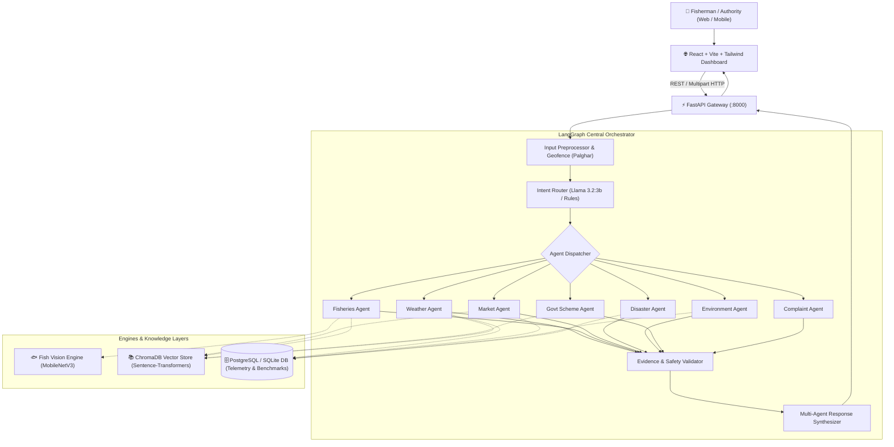

# 🌊 AquaPulse: AI-Powered Smart Fisheries & Coastal Safety System

[](http://127.0.0.1:8000)
[](http://127.0.0.1:8000/dashboard)
[](http://127.0.0.1:8000/docs)
[](http://127.0.0.1:8000/docs)

**AquaPulse** is a production-oriented, multi-agent AI system designed specifically for the coastal communities, fishermen, and port authorities of **Palghar district, Maharashtra** (spanning Satpati, Dahanu, Arnala, Kelve, and Vasai). 

The platform integrates deep learning computer vision, local retrieval-augmented generation (RAG), PostgreSQL telemetry storage, and a LangGraph multi-agent orchestrator with a modern ocean-themed React dashboard to deliver real-time marine advisories, market auctions, species identification, disaster alerts, and regulatory intelligence in **English, Hindi, and Marathi**.

---

## 📑 Table of Contents
1. [Key Features](#-key-features)
2. [System Architecture](#-system-architecture)
3. [The 7 Specialist AI Agents](#-the-7-specialist-ai-agents)
4. [Fish Vision Module](#-fish-vision-module)
5. [Domain RAG & Vector Store](#-domain-rag--vector-store)
6. [Tech Stack](#-tech-stack)
7. [Project Directory Structure](#-project-directory-structure)
8. [Installation & Setup](#-installation--setup)
9. [Running the Application](#-running-the-application)
10. [API Documentation](#-api-documentation)
11. [Testing & Quality Verification](#-testing--quality-verification)
12. [License & Acknowledgements](#-license--acknowledgements)

---

## ✨ Key Features

- **Multi-Agent LangGraph Orchestrator**: Coordinates 7 specialist domain agents with deterministic routing, rule-based fallback, and Ollama Llama 3.2:3b intent classification.
- **Fish Species Vision Classifier**: Classifies fish species using PyTorch MobileNetV3 with certainty scoring and fallback to Gemma contextual descriptions.
- **Grounded Vector Search (RAG)**: ChromaDB + Sentence Transformers embeddings over official IMD, INCOIS, CMFRI, MPCB, and MMFRA regulatory corpora.
- **Multilingual Query Processing**: Full support for conversational queries in English, Hindi, and Marathi (both Devanagari and Romanized text).
- **Zero-Hallucination Policy**: Adheres to strict evidence-grounding; missing parameters or unknown species trigger explicit warnings instead of fabricated measurements.
- **Unified Single-Port Deployment**: FastAPI serves REST endpoints, WebSocket-ready chat pipelines, and the compiled React production dashboard from port `8000`.

---

## 🏗️ System Architecture



---

## 🤖 The 7 Specialist AI Agents

| Agent Name | Core Responsibilities & Domain Data | Primary Sources |
|---|---|---|
| **Weather Agent** | Real-time marine weather, wind gusts, wave height, semi-diurnal tide times for creek navigation (Satpati/Dahanu), Safe-to-Sail index across 3 vessel categories. | IMD Mumbai, INCOIS Marine Radar, Open-Meteo |
| **Fisheries Agent** | Palghar commercial fish catalog, INCOIS Potential Fishing Zones (PFZ), minimum legal size (MLS), net mesh regulations, and MMFRA compliance. | ICAR-CMFRI Mumbai, MMFRA Gazette |
| **Market Agent** | Daily morning wholesale auction rates, landing center modal prices (Pomfret, Bombil, Mackerel, Surmai, Prawns), APMC 5% fee caps, and cold-chain logistics. | Satpati Sarvodaya Sahakari Society, APMC Palghar |
| **Disaster Agent** | Early warning monitoring for cyclones, high-swell surges, storm waves, tsunami watches, and 24x7 emergency contacts (**1077**). | IMD Cyclone Warning Centre, District Disaster Cell |
| **Environment Agent** | Water quality telemetry (DO, pH, Salinity, SST), Noctiluca algal bloom tracking, Tarapur MIDC CETP 1.5 km outfall compliance, and MPCB Class SW-II criteria. | MPCB, INCOIS Ocean Color Observation |
| **Government Scheme Agent** | PMMSY craft motorization subsidies (40–60%), Maharashtra High-Speed Diesel (HSD) 100% VAT refunds, and Kisan Credit Card (KCC) 4% working capital credit. | Ministry of Fisheries (GoI), Maharashtra GRs, NABARD |
| **Complaint Agent** | Intake and tracking of public maritime grievances (illegal bull trawling within 12 NM, LED light fishing, harbor lighting outages, effluent spills). | Assistant Commissioner of Fisheries, Palghar |

---

## 🐟 Fish Vision Module

The AquaPulse Fish Vision Module identifies marine species from field photographs taken at landing docks:
1. **Pre-validation**: Enforces size limits (max 10MB) and formats (`JPEG`, `PNG`, `WEBP`).
2. **Preprocessing**: Normalizes RGB dimensions to 224×224 using ImageNet channel statistics.
3. **Classification**: PyTorch MobileNetV3 / EfficientNet backbone classifies species into local taxa (Silver Pomfret, Bombay Duck, Indian Mackerel, Black Pomfret, Tiger Prawn).
4. **Confidence Gating**: Returns top-3 ranked predictions with percentage probabilities. If confidence is below 35%, it marks the specimen as `Unknown / Low Confidence` without fabricating facts.
5. **Agent Pipeline Binding**: Passes the identified species directly to the **Fisheries Agent** (for biological traits & legal size) and the **Market Agent** (for daily auction modal rates).

---

## 📚 Domain RAG & Vector Store

- **Vector Database**: ChromaDB with persistent storage in `chroma_data/`.
- **Embedding Model**: `sentence-transformers/all-MiniLM-L6-v2` (384-dimensional dense vectors).
- **Supported Formats**: Unstructured PDF, CSV auction spreadsheets, and regulatory TXT files.
- **Metadata Tagging**: Every chunk retains `agent_name`, `document_name`, `location`, `district`, `source`, `publication_date`, and `document_type`.
- **Agent Filters**: Dedicated logical metadata boundaries for all 7 specialist agents ensure zero cross-contamination.

---

## 💻 Tech Stack

### Backend
- **Framework**: FastAPI (Python 3.10+)
- **Multi-Agent Orchestration**: LangGraph, LangChain Core
- **LLM Engine**: Ollama (Llama 3.2:3b) with rule-based fallback
- **Vector DB**: ChromaDB, Sentence Transformers
- **Computer Vision**: PyTorch, Torchvision, Pillow
- **Database & ORM**: SQLAlchemy 2.0, PostgreSQL / SQLite, asyncpg / aiosqlite

### Frontend
- **Framework**: React 18, Vite 6
- **Styling**: Tailwind CSS (custom oceanic color palettes)
- **Icons**: Lucide React
- **Client Architecture**: Dynamic modular tabs (Chat, Vision, Weather, Alerts, Market, Environment, Schemes, Complaints)

---

## 📂 Project Directory Structure

```text
agent env/
├── README.md                          # Main project guide
├── aquapulse.db                       # Active SQLite / PostgreSQL storage
├── chroma_data/                       # ChromaDB persistent vector collections
└── AquaPulse/
    ├── Assests/                       # Raw reference imagery & assets
    ├── Docs/                          # Architecture & design documentation
    │   ├── agent_workflow.md
    │   ├── architecture.md
    │   └── database_schema.md
    ├── Test/                          # Comprehensive automated test suites
    │   ├── test_phase1.py             # Phase 1 foundation & schema tests
    │   ├── test_weather_agent.py      # Weather agent test suite
    │   ├── test_fisheries_agent.py    # Fisheries agent test suite
    │   ├── test_market_agent.py       # Market agent test suite
    │   ├── test_environment_agent.py # Environment agent test suite
    │   ├── test_scheme_agent.py       # Scheme agent test suite
    │   ├── test_fish_vision.py        # Computer vision module tests
    │   ├── test_rag_system.py         # ChromaDB RAG vector test suite
    │   ├── test_orchestrator.py       # Routing & intent tests (9/9)
    │   ├── test_orchestrator_integration.py # Multi-agent scenarios (12/12)
    │   └── verify_answers.py          # Ground-truth answer precision tests
    └── Build/
        ├── backend/                   # FastAPI application
        │   ├── requirements.txt       # Python dependencies
        │   └── app/
        │       ├── main.py            # Gateway entrypoint & static mount
        │       ├── core/              # Config, database & Ollama client
        │       ├── db/                # SQLAlchemy models & Palghar seed data
        │       ├── schemas/           # Pydantic agent contract schemas
        │       ├── agents/            # The 7 specialist agents
        │       ├── orchestrator/      # LangGraph state, router & graph
        │       ├── vision/            # PyTorch fish vision classifier
        │       ├── rag/               # ChromaDB ingestion & retrieval
        │       └── api/v1/            # Chat, vision & telemetry endpoints
        └── frontend/                  # React dashboard
            ├── package.json
            ├── vite.config.js
            ├── tailwind.config.js
            ├── dist/                  # Built production bundle (served by FastAPI)
            └── src/                   # React components & UI interfaces
```

---

## 🚀 Installation & Setup

### 1. Prerequisites
- **Python**: 3.10+ installed and added to `PATH`
- **Node.js**: v18+ and `npm`
- *(Optional)* **Ollama**: For running local `llama3.2:3b` (`ollama run llama3.2:3b`)

### 2. Backend Setup
```bash
# Navigate to the backend directory
cd AquaPulse/Build/backend

# Create and activate a virtual environment
python -m venv venv
# On Windows:
.\venv\Scripts\activate
# On Linux/macOS:
source venv/bin/activate

# Install dependencies
pip install -r requirements.txt
```

### 3. Frontend Setup
```bash
# Navigate to the frontend directory
cd ../frontend

# Install node dependencies
npm install

# Build production bundle for FastAPI static mounting
npm run build
```

---

## 🏃 Running the Application

### Option A: Unified Application (Recommended)
FastAPI serves the complete React production dashboard and all API endpoints together on a single port:

```bash
# From workspace root:
python -m uvicorn app.main:app --app-dir "AquaPulse/Build/backend" --host 127.0.0.1 --port 8000
```
- **Web Application Dashboard**: [http://127.0.0.1:8000/dashboard](http://127.0.0.1:8000/dashboard) or [http://127.0.0.1:8000/](http://127.0.0.1:8000/)
- **Interactive Swagger Documentation**: [http://127.0.0.1:8000/docs](http://127.0.0.1:8000/docs)
- **ReDoc Specification**: [http://127.0.0.1:8000/redoc](http://127.0.0.1:8000/redoc)

### Option B: Frontend Hot-Reload Development
If actively developing React components:
```bash
cd AquaPulse/Build/frontend
npm run dev
```
- **Vite Dev Server**: [http://localhost:5173/](http://localhost:5173/)

---

## 📡 API Documentation

### 1. Chat Orchestration (`POST /api/v1/chat/`)
Routes any conversational or technical inquiry to the appropriate agent(s).

**Request:**
```json
{
  "query": "What is the price of Silver Pomfret in Satpati?",
  "location": {
    "name": "Satpati",
    "district": "Palghar",
    "state": "Maharashtra"
  }
}
```

**Response:**
```json
{
  "user_query": "What is the price of Silver Pomfret in Satpati?",
  "session_id": "sess-1731737700",
  "intent": "market_pricing",
  "target_agents": ["market"],
  "final_answer": "Today's wholesale price for Silver Pomfret (Paplet (Large)): ₹850.0/kg (Range: ₹750.0 - ₹950.0/kg) at Satpati Fish Market. Auction Date: 05 Nov 2026.",
  "agent_results": {
    "market": {
      "agent_name": "Market Agent",
      "status": "success",
      "answer": "Today's wholesale price for Silver Pomfret (Paplet (Large)): ₹850.0/kg (Range: ₹750.0 - ₹950.0/kg) at Satpati Fish Market. Auction Date: 05 Nov 2026.",
      "confidence": 0.96,
      "warnings": []
    }
  },
  "sources": [
    {
      "source_name": "Satpati Fishermen Sarvodaya Sahakari Society",
      "data_mode": "live",
      "date": "05 Nov 2026"
    }
  ],
  "validation_passed": true,
  "completed_at": "2026-11-16T14:40:00Z"
}
```

### 2. Fish Vision Classification (`POST /api/v1/vision/classify`)
Accepts an image file (`multipart/form-data`) and classifies the species.

**Response:**
```json
{
  "predicted_species": "Silver Pomfret",
  "scientific_name": "Pampus argenteus",
  "local_name": "Paplet / Saranga (पापलेट)",
  "confidence": 0.88,
  "alternative_predictions": [
    {"species": "Black Pomfret", "confidence": 0.08},
    {"species": "Bombay Duck", "confidence": 0.04}
  ],
  "habitat": "Coastal pelagic waters (15-50m depth)",
  "seasonal_information": {
    "peak_season": "September to February",
    "minimum_legal_size": "15 cm (150g)"
  },
  "local_distribution": ["Satpati", "Arnala", "Dahanu", "Vasai"],
  "market_prices": [
    {
      "market_name": "Satpati Fish Market",
      "modal_price_per_kg": 850.0,
      "price_min_per_kg": 750.0,
      "price_max_per_kg": 950.0,
      "currency": "INR"
    }
  ],
  "price_source": "Satpati Fishermen Sarvodaya Sahakari Society Mandi Records",
  "price_date": "Today's Verified Auction",
  "warnings": []
}
```

---

## 🧪 Testing & Quality Verification

AquaPulse contains a full end-to-end automated test suite covering unit contracts, agent tools, vision models, RAG vector retrieval, and LangGraph integration scenarios:

```bash
# 1. Test Foundation Schemas & Database Models
python AquaPulse/Test/test_phase1.py

# 2. Test Multi-Agent Intent Routing (9/9 passed)
python AquaPulse/Test/test_orchestrator.py

# 3. Test Full Orchestrator Scenarios (12/12 passed)
python AquaPulse/Test/test_orchestrator_integration.py

# 4. Test Fish Vision MobileNetV3 Classifier (12/12 passed)
python AquaPulse/Test/test_fish_vision.py

# 5. Test ChromaDB Document Ingestion & RAG (11/11 passed)
python AquaPulse/Test/test_rag_system.py

# 6. Test Specific Agent Suites
python AquaPulse/Test/test_weather_agent.py
python AquaPulse/Test/test_fisheries_agent.py
python AquaPulse/Test/test_market_agent.py
python AquaPulse/Test/test_environment_agent.py
python AquaPulse/Test/test_scheme_agent.py

# 7. Test Question Specificity & Ground-Truth Verification
python AquaPulse/Test/verify_answers.py
```

---

## 🛡️ Data Integrity & Operational Boundaries
1. **No Hallucinated Facts**: AquaPulse will never fabricate numerical values (such as wave heights, market prices, or chemical metrics). When live observations are missing, it returns verified regional baselines accompanied by explicit data freshness warnings.
2. **Geographical Focus**: System intelligence, landing centers, and regulatory standards are calibrated specifically for **Palghar district, Maharashtra**. Out-of-region questions are courteously redirected to the proper authorities.

---

## 👥 Acknowledgements
- **Government of Maharashtra**: Department of Fisheries (MMFRA Regulations & Schemes).
- **ICAR-CMFRI**: Marine Fisheries Research data & Minimum Legal Size (MLS) standards.
- **INCOIS**: Potential Fishing Zone (PFZ) guidance & ocean state forecasts.
- **IMD**: Marine coastal weather thresholds and cyclone warnings.
